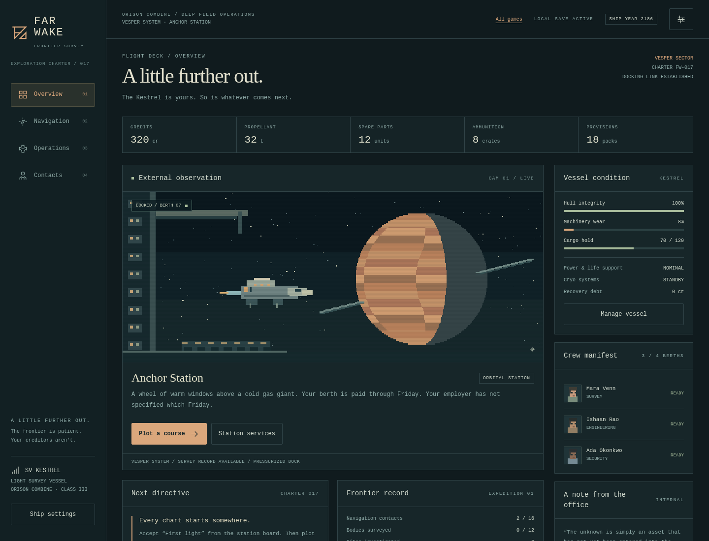

# FAR WAKE

**Play: https://rayners.github.io/explorer/** · [Source](https://github.com/rayners/explorer)

A casual exploration game about a small ship, a corporate charter, and the years between stars. Built for iPhone Safari, tablet browsers, and desktop. Original pixel artwork is generated by code; no external images, fonts, APIs, or accounts are required.

```sh
npm ci
npm run dev -- --host
```

Open the printed localhost URL on the desktop, or the printed LAN URL on a phone on the same network. Local HTTP supports gameplay and saves; installation and offline service workers on a phone require HTTPS hosting. Deploy the `dist/` output to a static HTTPS host when ready. Pushes to `main` run unit and browser tests, build the PWA, and deploy it to GitHub Pages through [the Pages workflow](.github/workflows/pages.yml). The workflow sets `PAGES_BASE_PATH=/explorer/`; local builds default to relative paths.

Accept **First light** on Overview, plot a course to **Cinder** in Navigation, and run an orbital survey in Operations. Return to a station and file the contract in Contacts. Surveys reveal routes and sites. Gather ice and ore, process them into supplies, and prepare for an interstellar crossing.

Interstellar routes depart from specific worlds: **Cinder → Wayfarer Exchange (Pale Reach)** and **Morrow → Union Anchorage (Meridian)**. If you are elsewhere, select the destination system to see the charted itinerary and travel to its departure world. Each leg requires its own order; journeys are not automatically queued.



## What is playable

- Four connected systems, sixteen locations, twelve exploration bodies, thirty-six sites, and twelve contracts.
- Local journeys, sublight interstellar travel, cryosleep, and a fictional ship calendar. A four-year voyage can take fifteen real minutes.
- Surveys, surface expeditions, mining, processing, repairs, machinery servicing, equipment upgrades, and three crew specialties.
- Station markets, paid work, faction relief, exclusive survey-data licensing, and reputation-dependent prices and contracts. Long voyages also change market conditions.
- Pirate encounters and player-initiated interception, with short combat rounds, evasion, bargaining, or cargo surrender.
- Recoverable damage and injuries. If stranded, request a recovery tow in Navigation; pay its debt through station work.
- Offline catch-up up to twenty-four hours. Activities stop at completion; encounters hold for your decision. Leaving the game cannot destroy your crew or ship.
- Local autosave, validated export/import, a backup before import/reset, a corruption backup, single-writer protection across tabs, and an installable offline PWA.

## Commands

| Command                     | Purpose                                                                     |
| --------------------------- | --------------------------------------------------------------------------- |
| `npm run dev -- --host`     | Serve the game locally and on the LAN.                                      |
| `npm run build`             | Typecheck and build the static PWA in `dist/`.                              |
| `npm run preview -- --host` | Serve the production build.                                                 |
| `npm test`                  | Simulation, save, content, architecture, portability, and pacing tests.     |
| `npm run test:e2e`          | Chromium desktop, WebKit iPhone 15 Pro Max, and WebKit iPad journeys.       |
| `npm run test:offline`      | Production catch-up and offline reload in Chromium and WebKit; build first. |
| `npm run simulate`          | Play the entire frontier headlessly across eight seeds.                     |
| `npm run icons`             | Regenerate the original pixel-art app icons.                                |

Browser tests need Playwright's Chromium and WebKit installations (`npx playwright install chromium webkit`); Linux may also need their OS libraries. The test configuration uses actual WebKit rather than Chromium with a mobile user agent.

Development only: `?speed=60` accelerates visible play. `window.__farWake.advance(seconds)` and `.state()` support browser testing. These helpers are excluded from the production build.

## Reusing the engine

`src/engine/` contains generic deterministic mechanics and portable save validation. It imports neither game content nor UI. `src/game/` supplies the science fiction setting, definitions, generated frontier, and writing. `src/ui/` supplies the themed browser console and artwork renderer. `src/main.ts` owns browser lifecycle, storage, sound, and tab coordination.

See [the engine guide](docs/ENGINE.md), [design and future work](docs/DESIGN.md), and [device acceptance checklist](docs/ACCEPTANCE.md). The Victorian detective fixture in `tests/victorian.test.ts` uses the same engine with districts, carriage fares, investigators, evidence, and societies.

Seeds currently vary frontier deposits and site identities within an authored four-system topology. Full procedural systems and missions, roguelite resets, and persistent unlocks are deliberately deferred.

## Saves and compatibility

The current save format and generation version are both **1**. Unsupported versions are rejected with an explanation; future format changes must supply explicit migrations before changing these versions. No legacy saves existed for the initial release.

Browser storage keys are `far-wake.save.v1`, `far-wake.backup.v1` (before import/reset), and `far-wake.corrupt.v1` (unreadable original). Saves are plain JSON with a checksum for accidental corruption, not an anti-cheat mechanism. Keep downloaded backups: browser storage can be cleared by the user or operating system. Settings can import a backup JSON copied from these keys.

HTTPS and localhost use atomic Web Locks for command ownership. HTTP LAN previews fall back to a renewable storage lease, checked before commands and saves. That fallback is best-effort coordination rather than an atomic browser lock; use one tab when testing over LAN HTTP. If coordination or storage is unavailable, save export remains accessible.
