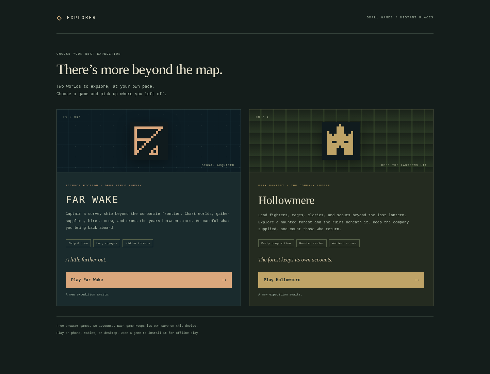
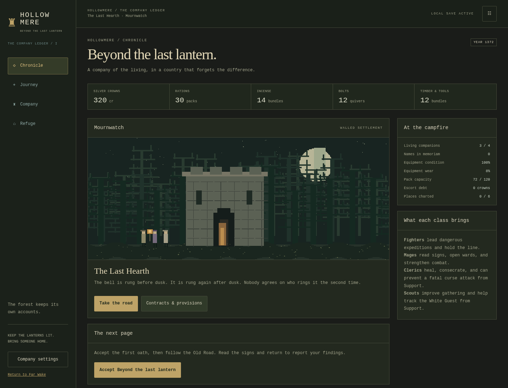

# FAR WAKE & HOLLOWMERE

**Game library: https://rayners.github.io/explorer/** · **Far Wake: https://rayners.github.io/explorer/far-wake/** · **Hollowmere: https://rayners.github.io/explorer/hollowmere/** · [Source](https://github.com/rayners/explorer)

Two casual exploration games share this site: Far Wake, about a small ship and the years between stars, and Hollowmere, about a company beyond the last lantern. Built for iPhone Safari, tablet browsers, and desktop. Original pixel artwork is generated by code; no external images, fonts, APIs, or accounts are required.

```sh
npm ci
npm run dev -- --host
```

Open the printed localhost URL on the desktop, or the printed LAN URL on a phone on the same network. Local HTTP supports gameplay and saves; installation and offline service workers on a phone require HTTPS hosting. Deploy the `dist/` output to a static HTTPS host when ready. Pushes to `main` run unit and browser tests, build the PWA, and deploy it to GitHub Pages through [the Pages workflow](.github/workflows/pages.yml). The workflow sets `PAGES_BASE_PATH=/explorer/`; local builds default to `/`.

Choose a game on the main page. Each card offers Play or Resume based on this device’s saved expedition; the library does not start or advance either game. Both games provide an **All games** link.

In Far Wake, accept **First light** on Overview, plot a course to the planet named in its brief in Navigation (**Cinder** in legacy expeditions), and run an orbital survey in Operations. Return to a station and file the contract in Contacts. Surveys reveal routes and sites. Gather ice and ore, process them into supplies, and prepare for an interstellar crossing.

Once a neighboring system is charted, you can depart from **any planet, moon, asteroid field, or station** in your current system. Select the destination system in Navigation and set course for a known location there. The displayed interstellar time and supply cost include local departure and arrival transfers. Journeys through intermediate systems still require separate orders.


## Game selection

The site root is the game library. Far Wake lives at `/far-wake/`; Hollowmere lives at `/hollowmere/`. Game definitions and simulations are not imported by the picker. Add future implemented games to `src/picker/catalog.ts` alongside their entry page and build input.

Moving Far Wake leaves its save, backup, preference, and lock keys unchanged. The existing root manifest URL remains available with an explicit install ID matching the former root start URL; its start page now points to Far Wake’s folder. A compatibility redirect handles older standalone installations that still launch the root. The **All games** links explicitly request the selector, including from those installations.



## New in v0.13

At stations and refuges, expand **Longer station shifts** or **Longer refuge duties** on the ordinary work card. Choose one 15-minute, one-hour or eight-hour order, with its pay, debt repayment and take-home amount shown before starting. Skills improve pay; duration stays fixed. Short active shifts remain more profitable per minute.

Each order pays and grants matching participants one practice point only when it finishes, including after offline absence. Cancel from its active-job panel to leave early, forfeiting the whole payout and practice. Support work remains independent; there is no repeat queue. Existing expeditions gain these options without a reset, with a validated schema-5 save upgrade that preserves old jobs. See [longer hub work](docs/WATCHES.md).

## New in v0.12

Both overviews put the current directive before the pixel scene. Hollowmere follows the first oath through travel, survey and reporting; Far Wake keeps its existing state-aware guidance. Larger decision text and stock labels, wrapping phone resources and a compact landscape layout make preparation easier to read.

Accepted discovery work now separates status, source, supplies, roles and next actions from expandable story and route estimates. Missing supplies and assignment problems stay visible, and opening details never issues an order. Existing expeditions gain these changes without a reset. See [readability and action hierarchy](docs/READABILITY.md).

## New in v0.11

Fresh expeditions add three discoveries per game: derelict salvage, a distress beacon and disputed research in Far Wake; a haunted shrine, lost caravan and dangerous bargain in Hollowmere. Choices can grant materials, recruit a medic/fighter, train specialists or change faction standing. Each response unlocks a distinct optional commission.

Some commissions use Support while an expedition works nearby; others need specialties split between Expedition and Support. Briefs show the teams, costs and consequences. These discoveries belong to generation 7; existing expeditions retain their original catalogs and remain playable. See [discovery variety](docs/VARIETY.md).

## New in v0.10

Both games now connect discovery contracts to expedition planning. A discovery-work summary highlights unlocked projects, accepted work and receipts ready to file. Briefs compare supplies and assigned specialists, including estimated travel to the source and back to a known hub.

Use **Plot route to source** or **Plot route to hub** to open the right map and preview the next leg. Plotting spends nothing; departures remain explicit. Completed work stays visible with return-and-file guidance. These improvements work with existing expeditions, including older discovery contracts—no reset is needed. See [expedition planning](docs/PLANNING.md).

## New in v0.9

Discovery decisions now unlock optional faction projects in both games. Your response determines the patron, supplies and specialist needed: company beacons, communal reserves, rescue routes, consecrated shelters and elder wards. Accept at a hub, return to the original site for work, then file the receipt once for payment and standing. Briefs explain the original decision and preparation.

Projects belong to new generation-6 expeditions. Existing expeditions retain their catalogs and progress. Starting a fresh expedition in Settings is optional; export your current save first if you want to keep a separate copy. See [faction projects](docs/PROJECTS.md).

## New in v0.8

Crew and companions earn practice by completing work in their specialty. At four and twelve points they become Practiced and Veteran, improving existing skill bonuses. Roster rows show progress; resting members do not gain work practice, and memorials retain it. Existing saves migrate without changing their maps or paid orders.

New expeditions can find a stranded engineer/pathfinder or recover useful knowledge. Offer a place or arrange resettlement; train specialists or release the knowledge to a faction. Names remain stable, accommodation still applies, and choices wait safely until a hub visit. These opportunities belong to generation 5; older expeditions keep their event catalogs. See [crew development](docs/CREW.md).

## New in v0.7

Fresh expeditions generate connected maps with optional systems/realms and new places, each feeding into sites and discovery contracts. Far Wake has four to six systems; Hollowmere has three to five realms. First journeys, service hubs and recovery remain reliable. Existing saves keep their original maps; a different seed through Settings creates a new world using the existing backup/confirmation flow. Both charts show actual links, and multi-leg fantasy journeys explain time and supplies.

Query-string game URLs also reload into the correct game offline. See [world generation](docs/WORLDS.md).

## New in v0.6

Explored generated sites now unlock follow-up contracts in both games. Accept at a hub, bring the displayed supplies and crew, return to the source for field work, then file the result for payment and faction standing. Site traits determine whether the work involves restoration, archives/lore, replacement stores, reconnaissance or a fuller investigation.

Current generation-3 expeditions gain these offers from existing discoveries. Costs, committed timers and completed receipts survive reloads and offline play; work and payment cannot be replayed by releasing the contract. See [discovery missions](docs/MISSIONS.md).

## New in v0.5

New expeditions in both games generate exploration sites with origins, conditions, opportunities and complications that affect play. After surveying, choose any unfinished site and a direct, cautious or optional specialist approach. Costs, returns, duration, incident risk and staffing requirements are shown before ordering. Choices remain committed across reloads and offline play; completed sites cannot be farmed.

Generation 3 keeps the generated names from v0.4. Existing expeditions retain their old sites and outcomes. That release retained authored geography; v0.6 added discovery-derived missions and v0.7 adds generated layouts. See [generated sites](docs/SITES.md).

## New in v0.4

Crew, faction, region and location names now come from seeded generation functions in both games. Themed vocabularies compose people and place names; recruits draw from 1,024 personal-name combinations instead of a handful of repeated cast names. Mission briefs, guidance, logs and faction choices use each expedition's names.

Existing saves keep their original names. Fresh expeditions use generation 2; change the seed in Settings to see another cast and world labels. The same seed/version reproduces the same names, without changing combat or discovery randomness. Geography and mission structure remain authored. See [name generation](docs/NAMES.md).

## New in v0.3

Ordinary surface expeditions can now bring back a hidden passenger, without choosing the specimen mission. Cinder and the first three explored sites are protected; later sites can produce occasional once-only discoveries. Hidden intrusions reveal after later work, then wait for your response. Time away never kills crew.

A recovered settlement claim creates a station follow-up: choose the Combine, the Free Habitats, or neutral archiving. Payments and faction standing are shown before confirmation; your decision persists and affects future dealings. Discoveries and their choices survive reloads, imports and offline play. Hollowmere retains its existing authored events. See [discovery event rules](docs/EVENTS.md).

## New in v0.2

**Far Wake:** recruit engineers, medical officers, security officers, and survey specialists from Contacts. The Kestrel has four berths; accommodation modules expand this to six and eight. New hires start resting, so assign them in Operations. Support medics unlock field triage and can prevent a fatal attack during the optional internal-threat scenario.

To investigate **Unmanifested cargo**, accept its contract at a station, survey the moon named in its brief (Morrow in legacy expeditions), and choose **Recover sealed specimen**. After the hidden incident develops, search, contain, confront, or vent the affected compartment. Failed explicit responses can permanently kill crew; ordinary offline catch-up never kills anyone. Venting is guaranteed to clear the organism at the cost of 20% of physical cargo. Casualties remain in a memorial and their berths can be filled by replacements. If everyone dies, a free relief hand is available at a station.

**Hollowmere** is a separate dark fantasy game with nine places across a threatened settlement, haunted forest, and underground ruins; six authored contracts plus eighteen generation-3 discovery follow-ups; original pixel landscapes; and its own saves. Fighters lead expeditions, mages open wards and bolster combat, clerics heal and consecrate, and scouts improve gathering. An optional reliquary investigation introduces the White Guest, a curse using the same internal-threat engine. Read [the Hollowmere guide](docs/HOLLOWMERE.md).



## What is playable

- Far Wake: four to six connected systems, with planets, moons and asteroid fields, three sites per field location and one optional follow-up per site. Generation-3 saves retain four systems, sixteen locations and thirty-six sites/follow-ups.
- Local journeys, sublight interstellar travel, cryosleep, and a fictional ship calendar. A four-year voyage can take fifteen real minutes.
- Surveys, surface expeditions, mining, processing, repairs, machinery servicing, equipment upgrades, and four recruitable specialist roles.
- Station markets, paid work, faction relief, exclusive survey-data licensing, and reputation-dependent prices and contracts. Long voyages also change market conditions.
- Pirate encounters and player-initiated interception, with short combat rounds, evasion, bargaining, or cargo surrender.
- Recoverable damage and injuries. If stranded, request a recovery tow in Navigation; pay its debt through station work.
- Offline catch-up up to twenty-four hours. Activities stop at completion; encounters hold for your decision. Leaving the game cannot destroy your crew or ship.
- Local autosave, validated export/import, a backup before import/reset, a corruption backup, single-writer protection across tabs, and an installable offline PWA.

## Commands

| Command                     | Purpose                                                                     |
| --------------------------- | --------------------------------------------------------------------------- |
| `npm run dev -- --host`     | Serve the game locally and on the LAN.                                      |
| `npm run build`             | Typecheck and build the static PWA in `dist/`.                              |
| `npm run preview -- --host` | Serve the production build.                                                 |
| `npm test`                  | Simulation, save, content, architecture, portability, and pacing tests.     |
| `npm run test:e2e`          | Chromium desktop, WebKit iPhone 15 Pro Max, and WebKit iPad journeys.       |
| `npm run test:offline`      | Production catch-up and offline reload in Chromium and WebKit; build first. |
| `npm run simulate`          | Play the entire frontier headlessly across eight seeds.                     |
| `npm run icons`             | Regenerate the original pixel-art app icons.                                |

Browser tests need Playwright's Chromium and WebKit installations (`npx playwright install chromium webkit`); Linux may also need their OS libraries. The test configuration uses actual WebKit rather than Chromium with a mobile user agent.

Development only: `?speed=60` accelerates visible play. `window.__farWake.advance(seconds)` and `.state()` support browser testing. These helpers are excluded from the production build.

## Reusing the engine

`src/engine/` contains generic deterministic mechanics and portable save validation. It imports neither game content nor UI. `src/game/` supplies the science fiction setting, definitions, generated frontier, and writing. `src/ui/` supplies the themed browser console and artwork renderer. `src/main.ts` starts Far Wake; `src/fantasy/` supplies Hollowmere. `src/browser/runtime.ts` owns their shared browser lifecycle, with separate storage keys, preferences, and command locks. Recruitment, party requirements, casualties, and internal threats are engine mechanisms; setting-specific roles, costs, writing, and art stay in each game.

See [the engine guide](docs/ENGINE.md), [design and future work](docs/DESIGN.md), and [device acceptance checklist](docs/ACCEPTANCE.md). The Victorian detective fixture in `tests/victorian.test.ts` uses the same engine with districts, carriage fares, investigators, evidence, and societies.

Current seeds vary names, sites and connected system/realm layouts, with discovery-derived contracts and bounded events/projects. Full procedural campaigns, roguelite resets and persistent unlocks remain deferred.

## Saves and compatibility

The JSON envelope format remains **1**, state schema is **5**, and content generation is independently versioned. Generations 1–7 preserve their original names, geography, sites, events and work catalogs. New expeditions use generation 7; restores keep the saved version.

Schemas 1–4 migrate after their original checksum and applicable legacy state are validated. Schema 4 adds practice/participants; schema 5 preserves those fields and all old jobs while permitting optional committed watch terms. No sites, names or paid jobs are rerolled, and no past practice is awarded retroactively. Unsupported future versions are rejected instead of silently regenerated. Export a backup before moving between application versions.

Browser storage keys are `far-wake.save.v1`, `far-wake.backup.v1` (before import/reset), and `far-wake.corrupt.v1` (unreadable original). Hollowmere uses the equivalent `hollowmere.*` namespace. Cross-game imports are rejected and both games can hold independent command locks. Saves are plain JSON with a checksum for accidental corruption, not an anti-cheat mechanism. Imports and resets keep the current expedition active until both its backup and replacement have been written; a storage failure leaves the current expedition intact and displays a persistent warning. Keep downloaded backups: browser storage can be cleared by the user or operating system. Settings can import a backup JSON copied from these keys.

HTTPS and localhost use atomic Web Locks for command ownership. HTTP LAN previews fall back to a renewable storage lease, checked before commands and saves. That fallback is best-effort coordination rather than an atomic browser lock; use one tab when testing over LAN HTTP. If coordination or storage is unavailable, save export remains accessible.

## Project documentation

Start with [AGENTS.md](AGENTS.md) for contributor and coding-agent guidance. The [documentation index](docs/README.md) links user goals, decision records, architecture, game designs, sources, implementation status and device acceptance. Future ideas are explicitly separated from implemented behavior.

Fresh expeditions use generated maps (generation 4): optional systems/realms and places, connected routes and service hubs, while preserving the introductory journey. Existing saves keep their original maps. [World generation](docs/WORLDS.md) records compatibility and validation. Run `node --import tsx scripts/simulate-world.ts` for generated campaigns in both themes.
